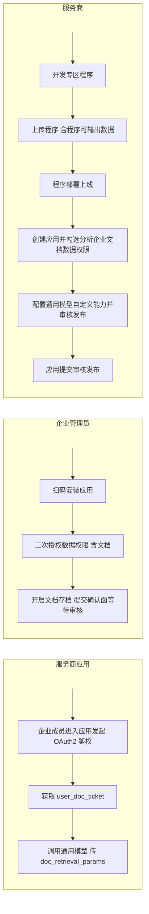

## 概述

企业微信支持应用在数据与智能专区中，检索企业授权的文档。本文档将引导服务商完成对接，包括服务商配置、企业授权、以及应用调用三个阶段。整体流程较长，涉及服务商、企业管理员等角色，建议按顺序完成。

::: tip 提示
目前该功能仅灰度开放，已灰度服务商为应用选择对应权限后，即可为企业提供文档检索服务。
:::

## 一、对接流程概览


 

::: tip 说明

- 通用模型自定义能力的配置（第 5 步）可以在其他步骤之前或之后进行
- **程序必须先完成部署上线**，才能在创建应用时选择该程序作为分析工具
:::

各阶段的具体步骤如下。

## 二、服务商配置

### 1. 开发专区程序

按照[专区程序开发指引](#54006)开发专区程序，也可以下载官方提供的示例程序镜像，参见[专区程序示例](#54166)。

::: tip 提示
如果服务商只需要使用文档检索而不需要分析企业会话数据，无需在专区程序中设置公钥。
:::

### 2. 上传程序并配置程序可输出数据

根据数据与智能专区[接入指引](#53518)"上传模型/程序"中的说明，将程序上传到专区。

在程序编辑页面，需要在**"程序可输出数据"**中添加程序支持的数据类型。企业微信预置了几种常见类型（如"会话搜索结果""客户标签""会话摘要"等），勾选所需项即可。
- 

若程序需要调用通用模型，可输出数据中还必须包含**自定义数据**。点击"添加"按钮后，在弹窗底部的**"添加自定义数据"**新增一项，名称由服务商自行定义。


### 3. 程序部署上线

程序上传后处于"新版本待部署上线"状态。在「程序详情」页点击右上角**"部署上线"**按钮，将当前版本发布为线上版本。
- 

程序镜像、程序可输出数据等任何修改都需要重新走一次"编辑 → 部署上线"流程。若在调试阶段需要频繁迭代，可使用**调试模式**避免每次都走部署上线流程，参见本文档第五章"调试与错误排查"。

### 4. 创建应用并勾选权限

在第三方应用或代开发应用的权限详情页中，勾选**"分析企业文档数据"**权限，并为该权限选择对应的分析工具（即第 3 步已部署上线的程序）。
- 

> "分析企业文档数据"、"分析会话内容"以及"分析知识集数据"是三个独立的权限项，若只勾选了会话权限，无法使用文档检索。

### 5. 配置通用模型自定义能力并审核发布

服务商需为通用模型配置自定义能力（即自定义输入协议），协议中**必须包含 `{doc_fragments}` 变量**，用于替换检索文档之后的片段数据。
- 

配置步骤：

1. 在通用模型管理页点击**"自定义模型能力"**按钮
2. 编辑提示词，确保协议中包含 `{doc_fragments}` 变量
3. **提交审核**
4. 审核通过后**发布**该自定义能力，即可使用对应的 `ability_id`（应用运行时调用通用模型接口需要传入）

::: warning 注意
通用模型的自定义能力（提示词 + `ability_id`）与专区程序的审核发布是**两套独立的流程**，互不影响。每次修改提示词都需要重新走「提交审核 → 发布」流程后才会生效。
:::

详见[通用模型能力接口](#56425)。

### 6. 应用提交审核发布

完成上述配置后，应用即可提交审核发布。

## 三、企业授权

本阶段操作由企业管理员完成，服务商需引导企业按以下顺序操作。

### 1. 安装应用

企业管理员扫码安装第三方应用或代开发应用。

> 扫码安装完成后，页面不会出现"下一步"提示，需引导企业管理员前往"管理工具 - 数据与智能专区"中查找应用并进行二次授权。

### 2. 授权数据权限

企业管理员在「企业管理后台 - 安全与管理 - 管理工具 - 数据与智能专区 - [应用名]」中为应用授权数据权限。授权时需勾选**文档**数据，并选择文档成员范围。
- 

- 数据范围：被授权成员有浏览权限的、浏览人数 ≥ 2 的公开文档会进入专区。
- 授权机制：数据有效期 90 天，到期后企业管理员需重新授权。

若企业尚未开启文档存档功能，授权页会展示开启指引，参见本章节第 3 步。

### 3. 开启文档存档

若企业尚未开启文档存档，企业管理员需在「管理工具 - 数据与智能专区 - 文档存档」中开启：

1. 启用文档存档功能
- 

2. 生成企业确认函
- 

3. 下载确认函，加盖企业公章后提交，等待企微侧审核
- 

> 确认函审核通常需要 1-3 个工作日。

## 四、应用调用

### 1. OAuth2 授权获取用户身份

企业成员需要通过 OAuth2 授权进入应用。若企业管理员已为应用开启数据与智能专区文档存档权限，应用调用[获取访问用户身份](#15122)时，企业微信会返回 `user_doc_ticket`。

- `user_doc_ticket` 有效期 30 天
- 凭此 ticket 可在调用数据专区通用模型时检索该用户有权限的文档

### 2. 调用通用模型能力

应用在调用[通用模型能力接口](#56425)时，传入 `doc_retrieval_params` 参数（包括关键词），企业微信数据专区会使用关键词对用户有权限的文档进行检索，将检索得到的片段替换输入协议中的 `{doc_fragments}` 变量，然后调用通用大模型。

请求示例：

```json
{
 "doc_retrieval_params": {
 "user_doc_ticket": "XXXXXXX",
 "keywords": ["差旅报销", "标准"],
 "creator_userid_list": ["UserA"],
 "create_time_start": 1700000000,
 "create_time_end": 1730000000
 }
}
```

### 3. 成员选择专区文档
应用可通过jsapi[数据与智能专区文档选择](#61186)或小程序接口[数据与智能专区文档选择](#61183)，让用户选择其创建的doc文档，应用即可获得相应文档的docid列表。

### 4. 通过前端组件展示文档标题
通过jsapi[数据与智能专区文档选择](#61186)或小程序接口[数据与智能专区文档选择](#61183)获取到文档url后，应用可通过[文档标题展示组件](#49823)在页面中展示文档的标题。

## 五、调试与错误排查

### 1. 调试模式

数据与智能专区中，程序与通用模型自定义能力的每次修改都需要走审核发布流程才能在正式版本中生效。在开发调试阶段，频繁的审核发布会降低迭代效率，此时可使用专区提供的**调试模式**。

调试模式下：
- 程序使用编辑版本而非正式版本，程序镜像、能力定义的修改无需经过审核发布即可生效
- 仅对开启调试模式的应用生效，不影响线上其他已授权企业
- 调试凭证有过期时间，过期后需重新开启

调试模式的开启方式、调试凭证获取、access_token 使用方式等详见[专区调试模式-调试说明](#54809)。

### 2. 接口日志查询

专区程序运行日志可在「管理端 - 数据与智能专区 - 日志查询」中查看，日志格式与 SDK 打印方式参见[专区程序开发指引](#54006)"专区程序的日志打印"章节。
